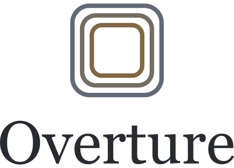

<!-- prettier-ignore -->

<picture>
  <source media="(prefers-color-scheme: dark)" srcset="https://raw.githubusercontent.com/AutoGitr/Overture/main/frontend/public/brand/overture-logo-stacked-dark.svg" />
  
</picture>

_Artwork, collections & themes for Plex, Jellyfin and Emby_

[Documentation](https://autogitr.github.io/Overture/overture) &#9679; [Install](https://autogitr.github.io/Overture/overture/install) &#9679; [Changelog](https://autogitr.github.io/Overture/overture/changelog) &#9679; [OvertureDB](https://github.com/AutoGitr/OvertureDB) &#9679; [Support](https://autogitr.github.io/Overture/overture/support)

Overture gives you complete control of your media library's look and sound.
Choose posters, backgrounds, season posters and theme songs yourself, or let
scheduled runs handle it automatically with the community picks in
[OvertureDB](https://github.com/AutoGitr/OvertureDB).

Your choices are saved as ordinary files beside your media, named the way your
media server expects, so they are backed up with it and survive server
reinstalls or switches.

## Features

- **Artwork in one place.** Compare candidates from your media server, TMDB and
  OvertureDB, sorted by resolution and ranked by visual similarity to your
  existing selection, or paste a link or upload your own.
- **Themes with a preview.** Choose OvertureDB or
  [ThemerrDB](https://github.com/LizardByte/ThemerrDB) picks, search YouTube or
  paste a link, and save as MP3 with optional loudness normalization.
- **Collections that maintain themselves.** Build collections from criteria,
  TMDB franchises and lists, MDBList lists and people, or one per decade, genre
  or studio; Overture keeps them in sync and can request missing titles from
  Radarr or Sonarr.
- **Automation you control.** Schedule library syncs and artwork or theme runs,
  with your own sources and order; saved choices are kept by default.
- **Choose ahead of time.** Pick art and themes for titles you don't have yet;
  Overture downloads them when the media arrives.
- **Keep the library tidy.** Renamer standardizes asset filenames, and Audit
  checks that your server shows and plays the files on disk.
- **Installable app.** Install Overture from the browser on desktop or phone.

## Links

- [Documentation](https://autogitr.github.io/Overture/overture)
- [Install with Docker or as a Linux service](https://autogitr.github.io/Overture/overture/install)
- [Getting started](https://autogitr.github.io/Overture/overture/features/getting-started)
- [Upgrade](https://autogitr.github.io/Overture/overture/administration/upgrade)
- [Verify a release](https://autogitr.github.io/Overture/overture/administration/verify-a-release)
- [Changelog](https://autogitr.github.io/Overture/overture/changelog)
- [Releases](https://github.com/AutoGitr/Overture/releases)

## Contributing

Share artwork and theme selections with
[OvertureDB](https://autogitr.github.io/Overture/overturedb/contributing), or
help improve Overture itself: see the
[contributor guide](CONTRIBUTING.md). Report security issues
[privately](SECURITY.md).

## License

Overture is licensed under [AGPL-3.0](../LICENSE).
