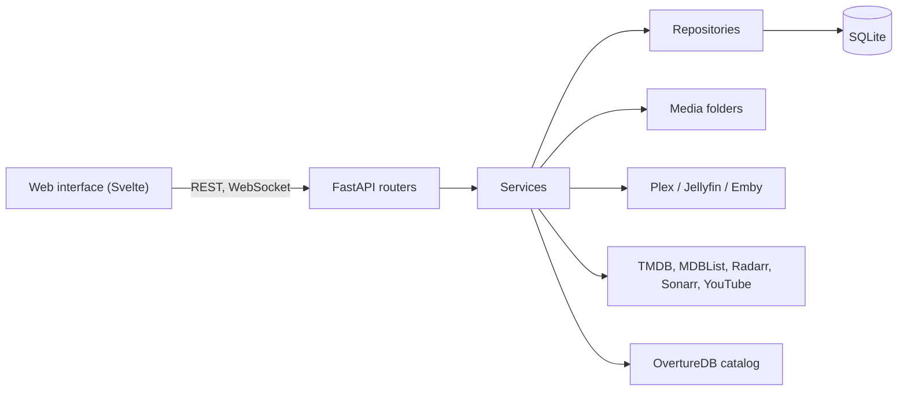

# Architecture

Overture is one container or service: a FastAPI backend that serves the built
Svelte web interface, keeps its state in a SQLite database and writes artwork
and themes into the media folders. It talks to one media server, to TMDB,
MDBList, Radarr and Sonarr when their keys are set, and downloads the
OvertureDB catalog from GitHub Pages.

## Repositories

- **Overture**: FastAPI backend in `src/overture/` with its tests in `tests/`,
  Svelte frontend in `frontend/`, native packaging in `packaging/linux/`, and
  this documentation in `docs/`.
- **OvertureDB**: the curated catalog, checked out as `../OvertureDB`. Its
  `schema/` directory is the authoritative catalog contract and `data/` holds
  the entries.

The two never drift. The contract is edited only in `../OvertureDB/schema/`
and copied into `src/overture/dataset_contract/`; rules both projects apply
(entry validation, the catalog format, canonical artwork links) live in the
contract and are imported from it. A change on one side that affects the other
is finished on both sides in the same task, and `SCHEMA_VERSION` is bumped
when the other side cannot read a catalog change as it stands.

## Backend layers

- `routers/` parse and authorise a request and call one service; they never
  open a session or hold business rules.
- `services/` own the rules, the transactions and what happens after them.
  `runtime.py` builds them and is the only place that wires services
  together. A feature package with several parts (`collections/`, `art/`)
  keeps each responsibility in its own class; its service class only assembles
  them, and routers depend on the one part they call.
- `repositories/` run queries against the session they are given; they never
  commit.
- `db/models/` hold the tables, `schemas/` the API contracts and
  `ws/events.py` the registry of WebSocket events.

Dependencies point inward: `routers` → `services` → `repositories` → `db`,
and everything may use `domain`, `utils` and `dataset_contract`. `domain`,
`utils`, `jobs`, `media_servers` and `repositories` never import `services`.

### Transactions and side effects

- `Database.write_session()` serialises every writer behind SQLite's single
  write lock, so write transactions stay short: no network calls, file I/O or
  hashing inside one. Blocking work runs with `owned_thread`.
- Asset locks (`AssetStorage.asset_locks`) are taken before opening a write
  session, never inside one, and held only around work that must not overlap
  on the same item or collection.
- Effects other parts observe happen after the transaction commits:
  broadcasts, scheduler registration, and waking download workers. A failed
  transaction leaves none of them behind.
- Work over many rows commits per item or per bounded chunk, so one failure
  rolls back only itself and the rest is counted.

### Security

Remote fetches go through the private-address guards (`utils/ssrf.py` and the
image fetch helpers), errors and logs through `sanitise_error`, and
credentials never reach URLs, responses or the browser.

## Frontend layout

- `src/generated/` holds the generated contracts from the OpenAPI description
  and WebSocket events; it is never edited by hand. The frontend talks to the
  backend only through the REST client and query helpers in `lib/rest/`;
  `lib/realtime/` applies WebSocket events to the cache and stores.
- Views live in `lib/router/` (pages), `lib/components/` and `lib/popups/`;
  client state in `lib/stores/`; pure helpers and `.svelte.ts` classes in
  `lib/utils/`. `src/test/` mirrors `src/`.
- Server data lives in the query cache. What is open, and in which view,
  lives in the URL. Stores hold only client state, such as UI preferences, and
  realtime projections.
- Styles are scoped to the component that renders the markup; `app.css` holds
  only design tokens and app-wide utilities.

## Guards

These tests fail when a change costs more or reaches across a layer:

- `tests/conftest.py` fails any test that makes a network request, starts
  blocking work or takes an asset lock inside a write transaction.
- `tests/test_architecture/test_layers.py` holds which layer may import which,
  and that only services open transactions.
- `tests/test_architecture/test_workloads.py` and `test_route_costs.py`
  measure statements, ORM entities and write size. An operation costs the same
  at twice the titles, and reads no large table end to end.
- `tests/test_release/test_capacity.py` holds time, memory and event-loop
  budgets.
- `frontend/.dependency-cruiser.mjs` holds the frontend's import rules,
  `frontend/scripts/check-bundle.ts` its download budget, and
  `src/test/e2e/performance.spec.ts` how long a large library may block the
  page.

## Database migrations

Every change that needs a migration ships with one. A model change is
autogenerated at head and reviewed; a new stored format converts existing
rows, including JSON copies in `saved_schedules.payload` and
`job_results.payload`, with the rule the app uses. Migrations chain from the
current head, implement `downgrade()`, and come with a test in
`tests/test_database/test_migrations.py` that seeds the previous revision.
Migrations run when Overture starts, after a backup.
